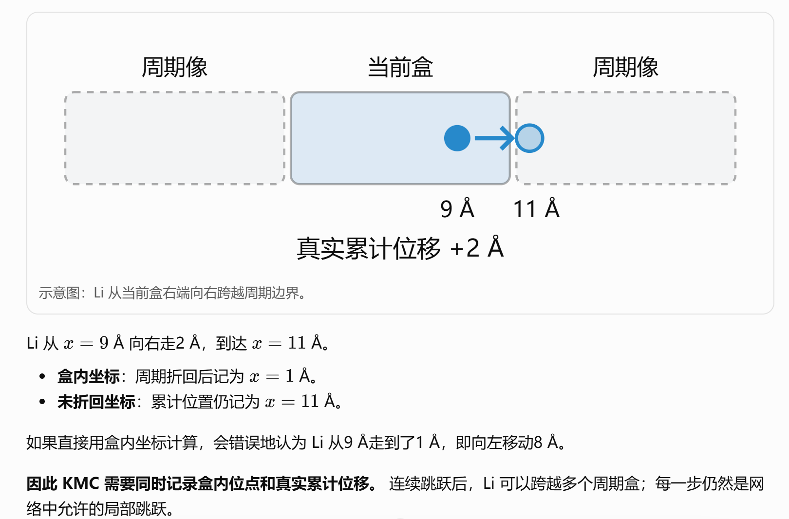

# C1 2.5KMC模拟

[C1 · 研究流程 / 3.代码执行、数据流](../../01-Research-Workflow/C1-NEB%E4%B8%8E%E8%BE%93%E8%BF%90%E5%88%86%E6%9E%90.md#3代码执行数据流) · [05 · KMC 代码与数据流](../../../05-Reproducible-Materials/C1-NEB-Calculations/04-Execution/KMC-practice-start-here.md)

## 1.目的
[扩散网络+path对应能垒→KMC→D（T）](../../01-Research-Workflow/C1-NEB%E4%B8%8E%E8%BE%93%E8%BF%90%E5%88%86%E6%9E%90.md#2方案)
## 2.输入 、内化 → 实践强化
### 材料层：

1. NEB → 跳跃门槛
KMC → 一定时间的扩散距离
**KMC模拟：**
给一个模型 → KMC生成符合规定的随机运动过程
目前模型为32Li位点 31Li 1空位 模型，每次允许1个相邻Li置换空位，包括PBC；
需要追踪每一个在迁移 Li 和 迁移的空位（得到 Li 的示踪扩散系数、空位扩散系数）
**Li跨越PBC边界：**
KMC在这个模型的计算盒中进行计算（类似63原子超胞），
当 Li 迁移出当前超胞时，Li从另一边折回计算盒内，
记录未折回坐标（相当于模拟向远处迁移，可以模拟真实晶体的规模）：

<p><a href="../../../assets/obsidian/kmc-periodic-displacement.png"></a></p>

2. **要知道D（粒子整体的迁移速度），需要先算出跳跃速率：**

```math
{\Gamma_i(T)=\nu_i\exp\!\left(-\frac{E_{m,i}}{k_BT}\right)}
```

- $`\Gamma_i(T)`$ -跳跃速率，单位 次/s ；
- vi -尝试频率，与原子在晶体的振动频率有关，决定跳跃发生快慢，单位 次/s
当前v=10^13，晶体常为10^12~13 量级，取值1个数量级的差距会导致最终结果相差10倍，
但作为有明确假设的计算模拟，这是严谨的。
（模拟就是在尽可能保留真实世界关键机制下，找出真实世界可能存在的规律）
- Em,i -第 i 类扩散路径的Em
- T -绝对温度，单位 k ；kB×T -热运动能量尺度
-  $`\exp\!\left(-\frac{E_{m,i}}{k_BT}\right)`$ -决定哪个路径更容易跳
## 算法层：

1. **如何选择 Li ：**
Li 空位作为节点，选择周围能和空位形成4种path之一的 Li 作为迁移对象
选择按占比随机选择：

```math
P_j=\frac{\Gamma_j}{\sum_j\Gamma_j}
```

2. **等待时间：**
需要加上原子振动但未成功跳出去的时间（简单体系下此公式适用）：

```math
\Delta t=-\frac{\ln u}{\sum_j\Gamma_j},
\qquad 0\lt u\lt 1
```

3. **从均方位移算出扩散系数：**
Li 可能迁移路程长，但位移短（如绕圈回到起点），
因此记录运动的距离采用均方位移（位移-平方-均值）：

```math
\mathrm{MSD}_{\mathrm{Li}}(t)
=\frac{1}{N_{\mathrm{Li}}}
\sum_{\alpha=1}^{N_{\mathrm{Li}}}
\left\langle
|\mathbf r_\alpha(t)-\mathbf r_\alpha(0)|^2
\right\rangle
```

当 t 足够长时，DLi（单位$`cm^2/s`$）：

```math
\boxed{D_{\mathrm{Li}}\approx
\frac{\mathrm{MSD}_{\mathrm{Li}}(t)}{6t}}
```

6t表示3维扩散，4t是2维，2t是1维

4. **KMC什么时候算够：**
由于存在随机性，需要检查统计结果是否趋于稳定。
检查的统计结果包括：
- 不同随机种子下的D是否足够相近——同样的随机种子对应一段相同的 Li 迁移轨迹
- 不同长度的D是否足够相近
- 低频迁移路径是否充分采样

5. **整个流程**
A 确定候选跳跃：空位-Li 匹配
B 计算各个候选跳跃的跳跃速率：跳跃的等待时间、跳跃速度 $`\Gamma_i(T)`$
C 按占比 $`P_j`$ 随机执行跳跃，并生成等待时间 $`\Delta t`$
D 不断更新状态：更新 跳跃 Li 身份、跳跃 Li 位置、空位位置、累计位移、模拟时间
E 上述过程不断循环，根据 $`\mathrm{MSD}_{\mathrm{Li}}(t)`$ 计算出 D（T），并检查收敛
## 实践：

1. 观察实际输入数据
2. 查看各个path的Em与对应Gamma（$`\Gamma_i(T)`$），四类路径对应6个候选跳跃
3. 查看空位如何和Li进行交换
4. 通过部分已有数据复算D，看结果是否稳定：
本次每个随机种子对应800万次跳跃事件（一开始100万，部分低频通道未被采样），
可以分成160个统计块，每块5万次跳跃模拟；
也可以分成320块，每块2.5万次。
总D根据统计块的D按时间加权汇总（$`t_b`$指每个统计块实际积累的模拟时间）：

```math
D_b=\frac{\mathrm{MSD}_b}{6t_b}，
    D=\frac{\sum_b D_b t_b}{\sum_b t_b}
```

收敛比较：不同随机种子的D；不同统计块的D；是否有未采样的正速率有向边（正速率指 跳跃速率 >0）