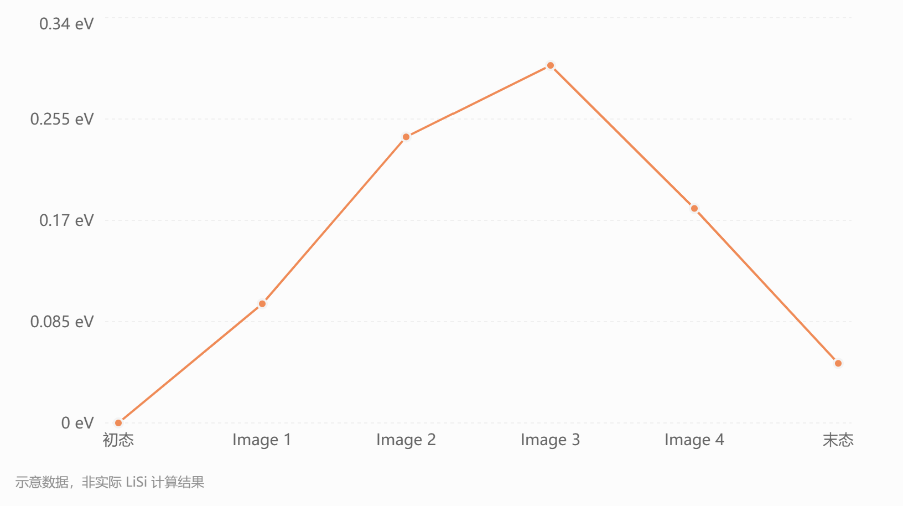
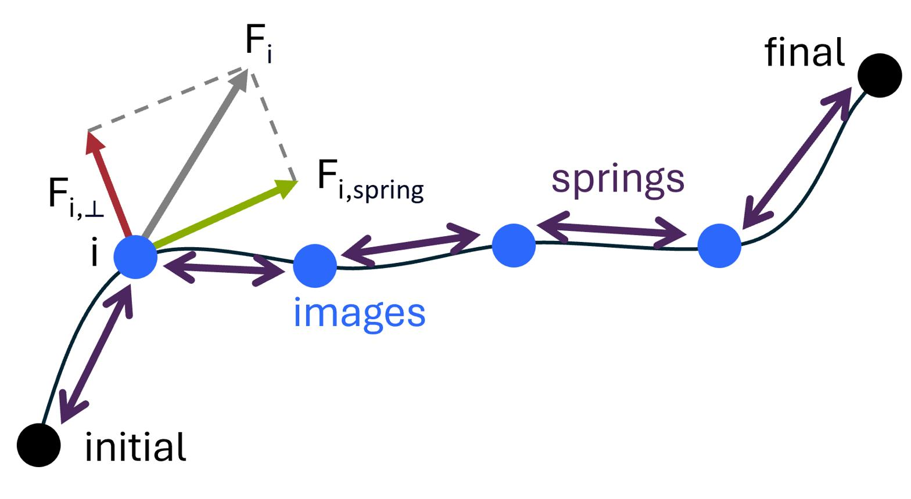
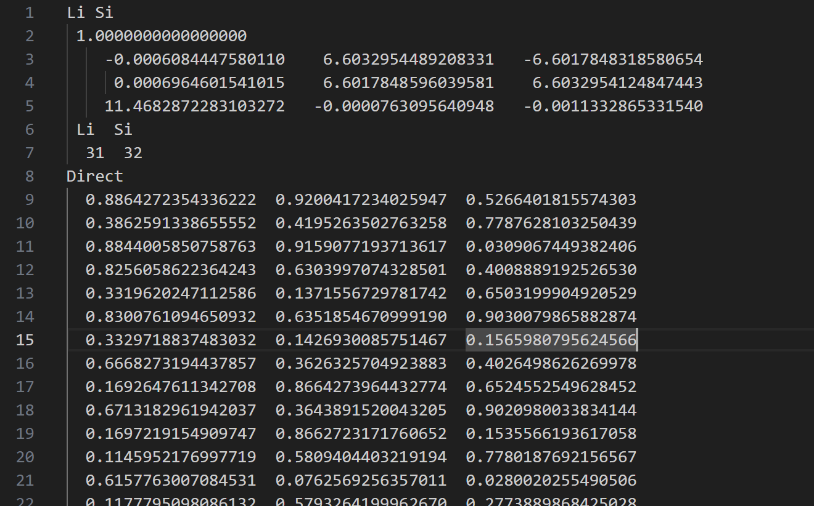
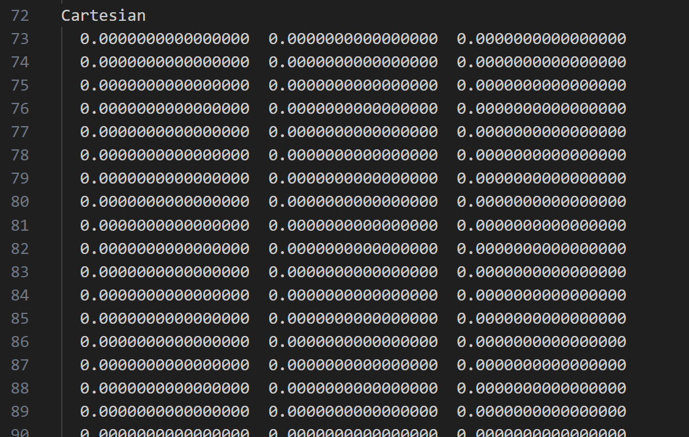

## 1.目的
[候选扩散路径→NEB→对应的能垒](C1-overview.md#2方案)
## 2.输入 、内化 → 实践强化
### 材料层：
1. **DFT可计算受力、体系能量**
2. **Li 迁移过程中经过斥力较强的区域，表现为体系能量升高（形成迁移能垒）**
**过渡态：** Li 迁移过程中体系能量最高的状态
**迁移能垒Em：** Em = E过渡态 - E初态
**最低能量路径：** 初态A→末态B，路径垂直方向受力趋于0的路径
（NEB得到的通常是局部能量最低路径，不保证在所有可能路径中能量最低）
3. **同一几何路径，正反两迁移方向Em可能不同**（这也是C1 2.3考虑过的问题）
但NEB有中间态，一次NEB计算就可以得出正反两个方向的Em。
因此没必要通过C1 2.3以为的方式再算一遍（[4.此前两个存疑的问题](C1-2.3-diffusion-paths.md#实践)），
但C1 2.3的方式可以充当对NEB结果的检验，当始末状态等价时还可以将始态映射到末态的结构
4. NEB→得出 Li 跳跃门槛
### 算法层：
**NEB的算法**
1. 构建中间构型：
构建中间 Li 的image（Li 在初始路径中的某个状态），
每个image包含62原子坐标+中间 Li 坐标，根据精度需要数个不同的image
2. 计算迁移能垒：
提取各个image的能量，和初始能量一起，绘制 始态→中间态→末态 拟合曲线，
横轴为迁移的位置状态（始态、image1、image2、……、末态）
纵轴为减去初态的相对能量

（CI NEB其中的一个image趋近于过渡态的位置，可以更准确得到过渡态能量）
3. 从中间构型→各个image的能量：
A 如何选image？
通过“中间插值法”：在初态A---末态B的连线中取几个等分点（只要有变化都会有中间插值）
但有时中间 Li 和其他原子靠的太近会出现难收敛、局部路径不准确的情况，
更加成熟的方法是IDPP插值，利用原子间距离优化初始image
B 每组image的计算类似于弛豫，但有不同。
普通弛豫只追求能量低，可能导致image的中间 Li 滑向始末位置，
NEB的方法：
①只保留垂直路径的分力——随优化能量降低但不会滑向两端
②不同image之间引入沿路径的“虚拟弹簧”，——让不同的中间构型（比如中间 Li ）保持一定距离（防止挤在一起）

C 流程
各个image → DFT电子自洽计算 → 各个image的受力、体系能量 → 
NEB处理受力，得到专门用于NEB优化的力 → 原子坐标调整 → 
形成新的各image构型 → 重复，直到满足NEB收敛要求（力收敛）

### 实践：
**INCAR参数**

| NEB几个重要参数         | 本次计算中的作用                                     |
| ----------------- | -------------------------------------------- |
| `IMAGES = 4`      | 优化4个中间构型                                     |
| `LCLIMB = .TRUE.` | 开启攀爬图像，让最高能量图像接近鞍点，开启之后，NEB→CI NEB           |
| `SPRING = -5`     | 设置虚拟弹簧；负号表示采用 NEB 处理，不是物理上的“负弹簧”             |
| `EDIFF = 1E-7`    | 每次电子自洽计算的能量收敛阈值，单位为 eV／整个体系                  |
| `EDIFFG = -0.02`  | 采用力停止条件，阈值为 **0.02 eV/Å**；这里要检查 NEB 优化所用的有效力 |
| `NSW = 24`        | 本段优化步数上限，不表示实际一定运行了24步                       |

1. **电子状态可以用波矢k描述**，DFT通过采集波矢得到电子状态，
**KPOINTS文件是波矢采样密度**，k 点越密，通常能量越精确，但计算成本越高
2. **ENCUT：** 截断能，vasp用平面波近似描述电子波函数，数值越高精度越大，但计算成本也越大
（目前ENCUT=520eV）
3. **SIGMA：** 电子展宽，金属材料的某些电子能级很接近，导致电子状态在 SCF 中反复变化，不容易收敛。
宽展宽相当于放大了能级差距，更容易收敛，
SIGMA数值越小，表示展宽越宽，但可能影响能垒；展宽太窄导致不容易收敛。
（目前ESIGMA=0.10eV）
2. 实际执行的方案是：NEB → CI NEB → 收敛检查

**POSCAR参数**
1. 开头的`1.0000000000000000`为缩放参数，`1.0000000000000000`表示数值单位为1埃
下面3行为晶格矢量
2. Direct：原子坐标，一行表示一个原子
3. Cartesian：原子的速度，和Direct的原子坐标一一对应
由于目前只是结构优化和弛豫，而不是动力学模拟，都不需要用到速度

  

4. **结果检验**，对于path00，
**正反能量检验：**
初态A → 末态B 和 初态B → 末态A的迁移能垒，只有`0.00000737eV`，几乎一致。
和C1 2.3等价端点的判断吻合。
**image收敛检验：** 
4个image能量都在`0.02 eV/Å`阈值内。力收敛标准通过
`FORCES: max atom, RMS    0.010787    0.001697`——原始数据采集结果，
`max atom=0.010787`表示受NEB有效力最大的原子
`RMS=0.001697`，RMS均方根，表示一个image中所有原子的NEB有效力总体大小
主要看前者`max atom`
**KPOINTS、INCAR参数检验：** （提高精度，比较改变前后的迁移能垒差距）
KPOINTS、ENCUT、SIGMA → 在控制变量的情况下分别进行相同构型单点计算
（改变INCAR参数，对已经经过弛豫的00-05这5个POSCAR重新进行SCF）；
IMAGES → 重新进行NEB优化
